# 📊 Analisis Komprehensif Proyek SuaraKita
> **Dokumen Evaluasi Kualitas, Keamanan, dan Roadmap Pengembangan Sistem Pengaduan & Aspirasi**

---

## 📋 Daftar Isi
1. [Ringkasan Eksekutif](#1-ringkasan-eksekutif)
2. [Kelebihan Proyek (Strengths)](#2-kelebihan-proyek-strengths)
3. [Kekurangan & Celah Sistem (Weaknesses & Vulnerabilities)](#3-kekurangan--celah-sistem-weaknesses--vulnerabilities)
   - [3.1 Celah Keamanan Kritis (Security)](#31-celah-keamanan-kritis-security)
   - [3.2 Inkonsistensi Data & Domain](#32-inkonsistensi-data--domain)
   - [3.3 Kualitas Kode & Maintainability](#33-kualitas-kode--maintainability)
4. [Peluang & Roadmap Pengembangan (Opportunities & Roadmap)](#4-peluang--roadmap-pengembangan-opportunities--roadmap)
   - [4.1 Peningkatan Fitur Inti Pengaduan](#41-peningkatan-fitur-inti-pengaduan)
   - [4.2 Peningkatan Panel Admin & Manajemen](#42-peningkatan-panel-admin--manajemen)
   - [4.3 Partisipasi Mahasiswa & Transparansi](#43-partisipasi-mahasiswa--transparansi)
   - [4.4 Notifikasi & Otomasi](#44-notifikasi--otomasi)
5. [Tabel Matriks Prioritas Pengerjaan](#5-tabel-matriks-prioritas-pengerjaan)

---

## 1. Ringkasan Eksekutif

**SuaraKita** adalah aplikasi berbasis web yang dirancang untuk mengelola aspirasi, keluhan, dan pengaduan dari siswa/mahasiswa kepada pihak institusi (sekolah/kampus). 

Aplikasi ini telah mengadopsi konsep **multi-tenant dasar** (pemisahan institusi menggunakan relasi `sekolah_id`) dan memiliki antarmuka yang modern berkat Tailwind CSS dan visualisasi Chart.js. Namun, dari segi fondasi rekayasa perangkat lunak, sistem ini masih menggunakan PHP prosedural murni dengan **sejumlah celah keamanan kritis (kategori High/Critical OWASP Top 10)** yang harus segera diperbaiki sebelum digunakan secara luas di lingkungan produksi.

---

## 2. Kelebihan Proyek (Strengths)

Meskipun masih dalam tahap awal, proyek ini memiliki nilai tambah dan fondasi yang patut diapresiasi:

1. **Arsitektur Multi-Tenant Terisolasi (`sekolah_id`)**:
   - Sistem sudah dirancang untuk menampung lebih dari satu institusi sekolah atau perguruan tinggi dalam satu database tunggal.
   - Query dasar telah memfilter data berdasarkan institusi masing-masing akun.

2. **Antarmuka Modern & Responsif**:
   - Memanfaatkan utilitas Tailwind CSS, tata letak antarmuka terlihat bersih dan modern, jauh dari kesan aplikasi web warisan (legacy).
   - Penggunaan animasi halus (*AOS - Animate On Scroll*) dan ikon terstruktur memberikan kenyamanan visual.

3. **Komunikasi Dua Arah (Tanggapan Interaktif)**:
   - Pengaduan tidak sekadar status pasif; terdapat fitur riwayat percakapan/tanggapan antara admin dan pelapor pada setiap tiket pengaduan.

4. **Visualisasi Data Bawaan**:
   - Dashboard admin telah dilengkapi grafik tren pengaduan bulanan menggunakan Chart.js, memudahkan pemantauan volume keluhan secara visual.

5. **Struktur File Terkelompok Cukup Rapi**:
   - Pemisahan direktori per peran (`admin/`, `siswa/`, `auth/`, `aksi/`, `partials/`) memudahkan navigasi berkas kode.

---

## 3. Kekurangan & Celah Sistem (Weaknesses & Vulnerabilities)

### 3.1 Celah Keamanan Kritis (Security)

> [!CAUTION]
> Celah-celah berikut dapat mengakibatkan pengambilalihan server (Server Takeover), kebocoran seluruh data pengguna, maupun manipulasi database oleh pihak tidak bertanggung jawab.

#### 1. Penyimpanan Password dalam Format Plaintext
- **Lokasi Berkas**: `database/suarakita.sql` & `aksi/aksi_login.php`
- **Uraian**: Password akun disimpan secara mentah (contoh: `admin123`, `1234567`) tanpa enkripsi *one-way hash*.
- **Risiko**: Jika file database bocor atau terkena SQL Injection, seluruh kredensial akun langsung terekspos.
- **Solusi**: Wajib menggunakan fungsi standar PHP `password_hash($password, PASSWORD_BCRYPT)` saat pendaftaran/ganti password dan `password_verify()` saat proses verifikasi login.

#### 2. Celah Remote Code Execution (RCE) pada Unggah Foto
- **Lokasi Berkas**: `admin/upload_foto.php` & `siswa/upload_foto.php`
- **Uraian**:
  ```php
  $ext = pathinfo($namaFile, PATHINFO_EXTENSION);
  $namaBaru = "profil_" . $id . "." . $ext;
  move_uploaded_file($tmpName, "../assets/img/" . $namaBaru);
  ```
  Tidak ada *whitelist* ekstensi file, tidak ada pemeriksaan MIME type, dan tidak ada pembatasan eksekusi skrip di folder tujuan.
- **Risiko**: Pengguna jahat dapat mengunggah file berbahaya (misal `shell.php`). File ini akan tersimpan di web root dan dapat diakses langsung melalui URL browser (`http://domain/assets/img/profil_1.php`) untuk mengeksekusi perintah terminal sistem operasi (RCE).
- **Solusi**:
  - Terapkan whitelist ekstensi ketat: `['jpg', 'jpeg', 'png', 'webp']`.
  - Validasi MIME type asli file dengan `finfo_file()` atau `mime_content_type()`.
  - Nonaktifkan eksekusi PHP pada direktori upload via konfigurasi web server (.htaccess / Nginx).

#### 3. Kerentanan SQL Injection (SQLi)
- **Lokasi Berkas**: Mayoritas berkas di folder `aksi/` dan query halaman admin/siswa.
- **Uraian**: Input pengguna langsung dimasukkan ke query string, contoh:
  ```php
  mysqli_query($config, "SELECT * FROM users WHERE username='$username'");
  mysqli_query($config, "INSERT INTO pengaduan (siswa_id, sekolah_id, judul, isi) VALUES ('$siswa_id', '$sekolah_id', '$judul', '$isi')");
  ```
- **Risiko**: Penyerang dapat menyisipkan payload SQL untuk mem-bypass autentikasi login atau mengekstrak tabel rahasia.
- **Solusi**: Wajib beralih 100% menggunakan **Prepared Statements** (`mysqli_prepare` atau PDO).

#### 4. Bypass Autentikasi: Redirect `header()` Tanpa `exit;`
- **Lokasi Berkas**: `admin/hapus_siswa.php`, `aksi/aksi_update_status.php`, `admin/dashboard_admin.php`, dll.
- **Uraian**:
  ```php
  if (!isset($_SESSION['login']) || $_SESSION['level'] != 'admin') {
      header("Location: ../login.php");
  }
  // Kode query DELETE / UPDATE di bawahnya tetap dieksekusi!
  ```
- **Risiko**: Perintah `header("Location: ...")` di PHP tidak menghentikan eksekusi script. Permintaan HTTP tanpa session login tetap dapat menjalankan query penghapusan data atau update data di bawahnya.
- **Solusi**: Setiap pemanggilan `header("Location: ...");` wajib langsung diikuti `exit;` atau `die;`.

#### 5. Kebocoran Privasi & Celah IDOR (Insecure Direct Object Reference)
- **Lokasi Berkas**: `siswa/detail_pengaduan.php` & `aksi/kirim_tanggapan_siswa.php`
- **Uraian**: Pada halaman detail pengaduan siswa, query hanya memvalidasi `sekolah_id`, namun **tidak memvalidasi `siswa_id`**:
  ```php
  WHERE p.id='$pengaduan_id' AND p.sekolah_id='$sekolah_id'
  ```
- **Risiko**: Siswa manapun dapat membaca isi pengaduan rahasia milik siswa lain (beserta identitas nama dan kelasnya) hanya dengan mengganti parameter ID di URL (`?id=1`, `?id=2`, dst.).
- **Solusi**: Tambahkan validasi kepemilikan data: `AND p.siswa_id = '$_SESSION[siswa_id]'` untuk hak akses siswa.

#### 6. Tidak Adanya Perlindungan CSRF (Cross-Site Request Forgery)
- **Uraian**: Form POST belum dilengkapi dengan token CSRF.
- **Risiko**: Penyerang dapat membuat situs web pihak ketiga yang secara otomatis mengirimkan aksi POST palsu atas nama user yang sedang login.

---

### 3.2 Inkonsistensi Data & Domain

1. **Inkonsistensi Terminologi Sekolah (SMK) vs Kampus (Perguruan Tinggi)**:
   - Skema tabel `users` memiliki atribut `nis` dan `kelas` (atribut sekolah menengah).
   - Namun di `index.php` dan antarmuka dashboard, istilah yang digunakan adalah **Mahasiswa**, **Dosen**, **NIM**, dan **Kampus**.
   - Solusi: Selaraskan bidang data menjadi generik (misal: `nomor_induk` dan `program_studi_atau_kelas`) atau buat sistem opsi sesuai jenis institusi.

2. **Hilangnya Identitas Admin pada Riwayat Tanggapan**:
   - Kolom tabel `tanggapan_pengaduan` hanya berupa `pengirim ENUM('siswa','admin')`.
   - Tidak ada kolom `user_id`. Jika sebuah institusi memiliki lebih dari 1 admin, tidak dapat diketahui siapa petugas admin yang menjawab laporan tersebut.

3. **Status Pengaduan Terlalu Minimalis**:
   - Status hanya `dikirim`, `diproses`, `selesai`.
   - Belum ada opsi status penolakan (`ditolak`) disertai alasan penolakan yang jelas bagi pelapor.

---

### 3.3 Kualitas Kode & Maintainability

1. **Gaya Kode Prosedural (Spaghetti Code)**:
   - Logika database, session check, sanitasi input, dan rendering HTML bercampur di satu berkas. Sulit diuji (*unit testing*) dan berisiko memunculkan bug saat kode bertambah besar.
2. **Ketiadaan Paginasi (Pagination)**:
   - Daftar pengaduan dan data siswa ditarik sekaligus (`SELECT *`). Ketika data mencapai ribuan entri, query akan membebani memory dan memperlambat waktu loading browser.
3. **Penyaringan Data Belum Ada**:
   - Tidak ada fitur filter pengaduan berdasarkan rentang tanggal, status, atau kata kunci pencarian.

---

## 4. Peluang & Roadmap Pengembangan (Opportunities & Roadmap)

```mermaid
flowchart LR
    subgraph Fase1 ["Fase 1: Keamanan & Fondasi"]
        F1A["Prepared Statements (Anti-SQLi)"]
        F1B["Bcrypt Password Hashing"]
        F1C["Whitelist & Sanitasi Upload File"]
        F1D["Fix IDOR & Exit on Redirect"]
    end

    subgraph Fase2 ["Fase 2: Fitur Inti Pengaduan"]
        F2A["Lampiran Bukti Foto / Dokumen"]
        F2B["Kategori & Prioritas Keluhan"]
        F2C["Mode Laporan Anonim"]
        F2D["Alur Status Lengkap + Alasan Penolakan"]
    end

    subgraph Fase3 ["Fase 3: Operasional & Pelaporan"]
        F3A["Ekspor Laporan PDF & Excel"]
        F3B["Filter Canggih & Pagination"]
        F3C["Indikator SLA (Peringatan Telat Respon)"]
        F3D["Rating Kepuasan Pelapor (CSAT)"]
    end

    subgraph Fase4 ["Fase 4: Otomasi & Komunikasi"]
        F4A["Notifikasi WhatsApp Gateway / Email"]
        F4B["Upvoting Aspirasi Publik"]
        F4C["Disposisi Unit / Departemen Terkait"]
    end

    Fase1 --> Fase2 --> Fase3 --> Fase4
```



### 4.1 Peningkatan Fitur Inti Pengaduan
* 📎 **Lampiran Bukti (File Uploads)**: Tambahkan kemampuan melampirkan foto kerusakan fasilitas atau dokumen pendukung dengan kompresi otomatis dan preview gambar.
* 🕶️ **Mode Pengaduan Anonim (Whistleblower Protection)**: Pelapor dapat mencentang opsi *"Kirim sebagai Anonim"*. Identitas pelapor disembunyikan dari publik/admin tingkat bawah demi mencegah intimidasi, namun tiket tetap bisa diproses.
* 🏷️ **Kategori & Tingkat Urgensi**: Pengelompokan pengaduan:
  - *Kategori*: Sarana & Prasarana, Pelayanan Akademik, Dosen / Pengajar, Keuangan, Keamanan, Kebersihan.
  - *Prioritas*: Rendah, Sedang, Tinggi, Darurat.
* 🔄 **Timeline Status yang Jelas**: Alur status interaktif:
  `Terkirim` ➔ `Ditinjau` ➔ `Sedang Ditangani` ➔ `Menunggu Konfirmasi Pelapor` ➔ `Selesai` atau `Ditolak (disertai alasan)`.

### 4.2 Peningkatan Panel Admin & Manajemen
* 📄 **Ekspor Rekap Laporan Resmi (PDF & Excel)**: Cetak rekapitulasi data keluhan berdasarkan rentang tanggal, kategori, atau status untuk diserahkan ke pimpinan (Kepala Sekolah / Rektor) sebagai bahan evaluasi bulanan.
* 🔍 **Fitur Pencarian, Filter, & Pagination**: Mempermudah admin mengelola ratusan data dengan filter kategori, status, dan kolom pencarian instan.
* ⏱️ **Indikator SLA (Service Level Agreement)**: Sistem otomatis menandai pengaduan dengan warna merah jika belum mendapat respons lebih dari 2x24 jam sejak dikirimkan.
* 🏢 **Disposisi ke Divisi/Unit Terkait**: Admin dapat menugaskan tiket ke unit kerja spesifik (misal: Biro Sarpras, Bagian Keuangan, atau Tim IT).

### 4.3 Partisipasi Mahasiswa & Transparansi
* 👍 **Upvote / Dukungan Aspirasi Publik**: Untuk aspirasi fasilitas umum (misal perbaikan parkiran, AC ruangan, atau sinyal WiFi), mahasiswa lain dapat memberi dukungan/upvote sehingga pihak kampus tahu masalah mana yang paling mendesak bagi mayoritas mahasiswa.
* ⭐ **Rating Kepuasan Penanganan (Feedback CSAT)**: Setelah pengaduan diselesaikan, pelapor dapat memberikan bintang 1–5 dan ulasan atas kecepatan serta kualitas penanganan pihak kampus.

### 4.4 Notifikasi & Otomasi
* 📲 **WhatsApp Gateway / Email Notification**: Pelapor menerima pemberitahuan otomatis ke ponsel saat ada tanggapan baru dari admin atau saat status pengaduan diperbarui.

---

## 5. Tabel Matriks Prioritas Pengerjaan

| Tingkat Prioritas | Item Tindakan | Estimasi Dampak | Kesulitan |
| :--- | :--- | :--- | :--- |
| **P0 (Kritis)** | Ganti plaintext password dengan `password_hash()` | Mencegah kebocoran akun secara massal | Mudah |
| **P0 (Kritis)** | Perbaiki celah RCE di `upload_foto.php` (whitelist ekstensi & MIME check) | Mencegah server diretas melalui file webshell | Mudah |
| **P0 (Kritis)** | Pasang `exit;` pada seluruh redirect `header("Location: ...")` | Menutup celah bypass autentikasi | Sangat Mudah |
| **P0 (Kritis)** | Terapkan Prepared Statements untuk seluruh query SQL | Mencegah eksploitasi SQL Injection | Sedang |
| **P0 (Kritis)** | Tutup celah IDOR di detail pengaduan siswa | Melindungi kerahasiaan pengaduan siswa lain | Mudah |
| **P1 (Tinggi)** | Tambahkan fitur **Upload Foto Bukti Pengaduan** | Meningkatkan keabsahan laporan yang masuk | Sedang |
| **P1 (Tinggi)** | Tambahkan kolom **Kategori** dan **Tingkat Urgensi** | Mempermudah klasifikasi dan penanganan | Mudah |
| **P1 (Tinggi)** | Tambahkan fitur **Filter, Pencarian, & Pagination** di panel Admin | Mencegah penurunan performa & memudahkan kerja admin | Sedang |
| **P2 (Menengah)** | Fitur **Ekspor Laporan PDF & Excel** | Kebutuhan pelaporan birokrasi & rapat pimpinan | Sedang |
| **P2 (Menengah)** | Opsi **Pengaduan Anonim** & Status Alasan Penolakan | Meningkatkan rasa aman dan kepercayaan pelapor | Mudah |
| **P3 (Lanjutan)** | Integrasi WhatsApp Gateway / Notifikasi Email | Memberikan pengalaman pengguna yang profesional | Sedang |
| **P3 (Lanjutan)** | Fitur **Upvoting Aspirasi Publik** & Rating Bintang (CSAT) | Mendorong keterlibatan aktif mahasiswa | Sedang |

---

*Dokumen ini disusun sebagai panduan teknis pengembangan dan penguatan arsitektur platform SuaraKita.*
